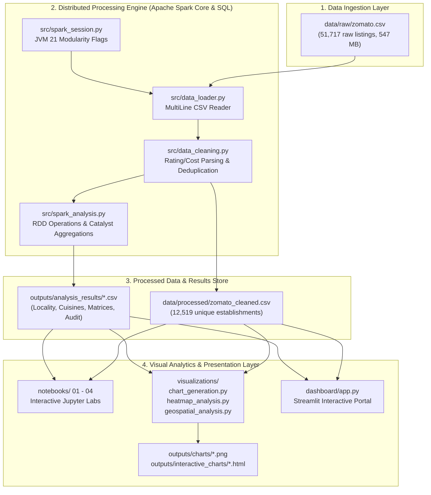
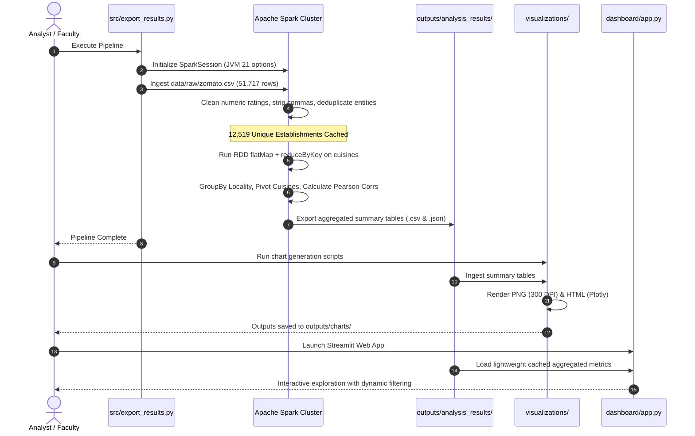

# System Architecture & Technical Workflow

## 1. High-Level Project Architecture

The **Zomato Bangalore Restaurant Analytics** system is architected as an end-to-end Big Data Analytics solution decoupling high-throughput distributed processing (Apache Spark) from interactive visual exploration (Streamlit, Plotly, Seaborn).

---

## 2. Component Responsibility Breakdown

| Component | File Path | Primary Responsibilities | Dependencies |
| :--- | :--- | :--- | :--- |
| **Spark Engine** | `src/spark_session.py` | Configures JVM flags for Java 21 LTS, allocates local worker cores (`local[*]`), configures shuffle partitions (8), and exposes managed SparkSession factory. | `pyspark`, `Java 21` |
| **Data Ingestion** | `src/data_loader.py` | Ingests multi-line CSVs with embedded quote escapes. Provides schema inspection and row count telemetry. | `src/spark_session.py` |
| **Data Cleaning** | `src/data_cleaning.py` | Normalizes strings, parses `rate` (`'4.1/5'` to `4.1`; `'NEW'`/`'-'` to `null`), cleans `approx_cost` (strips `,`), and eliminates multi-zone listing duplicates on `[name, address, location]`. | `src/config.py` |
| **Spark Analytics** | `src/spark_analysis.py` | Executes RDD operations (`map`, `filter`, `flatMap`, `reduceByKey`) and Catalyst DataFrame aggregations. Computes locality profiles, thresholded cuisine ratings, price tiers, correlations, and 2D locality-cuisine matrices. | `src/config.py`, `pyspark.sql` |
| **Pipeline Runner** | `src/export_results.py` | Orchestrates the entire processing lifecycle and persists cleaned datasets and aggregated CSVs to `outputs/analysis_results/`. | `src/*` |
| **Static Visualizer** | `visualizations/chart_generation.py` | Generates 300 DPI Matplotlib/Seaborn figures for formal academic reports. | `matplotlib`, `seaborn`, `pandas` |
| **Heatmap Engine** | `visualizations/heatmap_analysis.py` | Constructs high-dimensional locality vs. cuisine supply matrix heatmaps in static PNG and interactive HTML formats. | `seaborn`, `plotly` |
| **Spatial Engine** | `visualizations/geospatial_analysis.py` | Analyzes geographic concentration percentiles (Pareto distribution) and spatial density clusters without inventing synthetic coordinates. | `matplotlib`, `plotly` |
| **Streamlit Portal**| `dashboard/app.py` | Interactive web dashboard featuring real-time sidebar filters, dynamic KPI metrics, and tabbed analytical views. | `streamlit`, `plotly` |

---

## 3. Detailed Data Flow Architecture

---

## 4. Optimization & Modularity Strategies

1. **Catalyst Optimizer Leverage**: All analytical aggregations are constructed using native DataFrame expressions before an action is invoked, enabling Catalyst projection pruning and predicate pushdown.
2. **Decoupled Browser Layer**: The Streamlit dashboard never loads or processes the heavy 547 MB raw dataset during user interactions. Instead, it operates exclusively on the pre-aggregated Spark summaries and the compact cleaned CSV, guaranteeing responsive sub-second UI interactions.
3. **Lazy Evaluation & Caching**: Cleaned DataFrames are persisted in Spark memory (`cache()`) prior to executing the 9 analytical queries, avoiding redundant disk re-reads.
