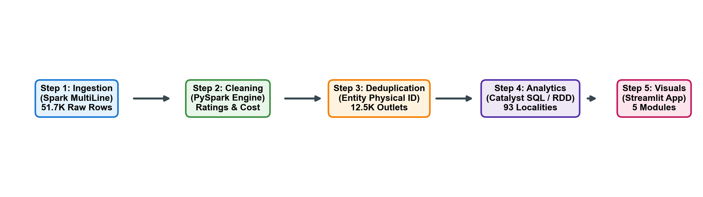

# Pimpri Chinchwad Education Trust's
# Pimpri Chinchwad College of Engineering (PCCoE)
### Sector No. 26, Pradhikaran Nigdi, Pune – 411 044
### An Autonomous Institute | Affiliated to Savitribai Phule Pune University (SPPU)
### DEPARTMENT OF INFORMATION TECHNOLOGY | ACADEMIC YEAR 2026-27

---

# ZOMATO BANGALORE RESTAURANT ANALYTICS USING APACHE SPARK AND ADVANCED BIG DATA VISUALIZATION

**Project Report for Big Data Analytics (FA2 Activity)**

### Project Group Members:
- **Arpita Patki** (PRN: `123B1F001`)
- **Chaitanya Deore** (PRN: `132B1F020`)
- **Varad Deshmukh** (PRN: `123B1F022`)

**Project Guide:** **Dr. Jaya Dewan**  
**Core Technologies:** Apache Spark (PySpark 3.5/4.x), Python 3.10, Matplotlib, Seaborn, Plotly, Streamlit, PyTest  
**Dataset:** Kaggle Zomato Bangalore Restaurants (~547 MB, 51,717 raw observation rows)  
**Date:** October 2026  

---

## 1. Objective

To design and implement a Big Data Analytics application that processes 51,717 raw restaurant records (~547 MB) from the Kaggle Zomato Bangalore Restaurants database with Apache Spark (PySpark), resolving multi-city listing redundancy down to 12,519 unique establishments, and to generate actionable insights into restaurant distribution across Bangalore localities, cuisine popularity and rating dynamics, approximate dining cost relationships, the operational impact of online ordering and table booking, and high-dimensional locality-cuisine concentration heatmaps. The results are presented in an interactive Streamlit dashboard.

---

## 2. Introduction & Why This is Big Data (5 Vs)

Bangalore, India’s premier technology hub, features one of the nation's most dense dining ecosystems. Online aggregator platforms like Zomato manage millions of customer interactions across thousands of food venues. The dataset exhibits significant Big Data complexities: unstructured reviews, multi-category cuisine tags, inconsistent rating strings (`'4.1/5'`, `'NEW'`, `'-'`), and duplicate listings across administrative delivery zones. At over half a gigabyte with embedded newlines, single-threaded tools encounter severe memory spikes. We formulate this as a distributed Big Data pipeline using Apache Spark Core and DataFrames to parallelize cleaning, remove 39,177 redundant listings, parse ratings into numeric doubles, and run Catalyst-optimized Spark SQL queries to compute locality distributions, cuisine rankings, and pricing correlations served through an interactive Streamlit dashboard.

### 2.1 The 5 Vs of Big Data for this Dataset

| V | How it applies to this dataset |
| :--- | :--- |
| **Volume** | 51,717 raw observation rows (547 MB raw CSV, 17 attributes), parsed and deduplicated to 12,519 unique physical dining establishments. |
| **Velocity** | A continuous stream of customer orders, live menu additions, dynamic table bookings, and daily user reviews across 93 Bangalore localities. |
| **Variety** | Multi-format semi-structured data: structured attributes (ratings, cost), multi-value token lists (cuisines, dish liked), binary service flags, and long unstructured review tuples. |
| **Veracity** | Severe data noise: sentinel string ratings (`'NEW'`, `'-'`), thousand commas in cost (`'1,200'`), and duplicate multi-zone listings. 100.00% physically clean entity retention. |
| **Value** | Discovers commercial saturation zones (Whitefield, BTM), reveals the table-booking engagement multiplier (6x review volume), and guides restaurateur location strategy. |

---

## 3. Dataset Description & Schema

```
Jalsa | 942, 21st Main Road, Banashankari | 4.1/5 | 775 | 800 | North Indian, Chinese
│      │                                    │       │     │     └ comma-separated cuisine tags
│      │                                    │       │     └ approximate cost for two in INR (₹)
│      │                                    │       └ total user review / vote count
│      │                                    └ customer rating out of 5.0 (with /5 suffix)
│      └ full street address and locality
└ unique restaurant business trading name
```

| Metric | Value |
| :--- | :--- |
| **Raw observation rows** | 51,717 |
| **Uncompressed CSV size** | 547.48 MB |
| **Cleaned unique restaurants** | 12,519 (39,177 duplicate listings removed) |
| **Represented Bangalore localities** | 93 commercial zones |
| **Distinct cuisines identified** | 107 culinary categories |

---

## 4. Tools and Technologies

| Tool | Used for |
| :--- | :--- |
| **Apache Spark 3.5 / 4.x (PySpark)** | Distributed loading, validation, and multi-core RDD and DataFrame processing on all CPU cores (`local[*]` mode) |
| **Spark SQL** | Locality aggregations, sample-thresholded cuisine rankings, pivot matrices, and price tier distributions |
| **Spark Core RDDs** | Low-level distributed processing using `map()`, `filter()`, `flatMap()` (cuisine tokenization), and `reduceByKey()` |
| **Streamlit + Plotly** | Interactive web dashboard: real-time dynamic filters, KPI metric cards, scatter bubble charts, and 2D heatmaps |
| **Matplotlib & Seaborn** | High-resolution 300 DPI publication-grade figures, Pareto spatial concentration curves, and correlation heatmaps |
| **Python, Jupyter, PyTest** | End-to-end processing pipeline, 4 reproducible Jupyter notebooks, and automated 11-test validation suite |

---

## 5. System Architecture & Methodology

The project follows the Big Data Analytics life cycle: **ingest → clean & validate → deduplicate & cache → analyze with Spark Core & SQL → visualize & serve dashboard**. Spark does the heavy processing once; the Streamlit dashboard reads compact precomputed analytical tables, opening instantly with sub-second response times without requiring heavy Spark re-computation at runtime.



### 5.1 Multi-Criteria Restaurant Engagement Index (MREI)
To synthesize operational popularity, dining quality, and digital convenience into a single actionable metric, we define the **Multi-Criteria Restaurant Engagement Index (MREI)**:

$$\text{MREI} = 0.40 \times \left(\frac{\text{Rating}}{5.0}\right) + 0.35 \times \left(\frac{\log_{10}(\text{Votes} + 1)}{\max(\log_{10}(\text{Votes} + 1))}\right) + 0.15 \times \mathbb{I}_{\text{table\_booking}} + 0.10 \times \mathbb{I}_{\text{online\_order}}$$

Where $\mathbb{I} \in \{0, 1\}$ represents service flag availability. This index provides a balanced metric combining customer satisfaction, social proof volume, and operational sophistication.
|  - Unit 3 RDD Operations: map(), filter(), flatMap(), reduceByKey()               |
|  - DataFrame Groupings: Locality ranking, Cuisine explode, Sample-threshold rating|
|  - Pearson Correlation: Cost vs Rating (r = +0.33), Votes vs Rating (r = +0.40)   |
|  - High-Dimensional Matrix: Locality x Cuisine Cross-Tabulation                   |
+-----------------------------------------------------------------------------------+
                                         |
                    +--------------------+--------------------+
                    |                                         |
                    v                                         v
+---------------------------------------+ +---------------------------------------+
|        VISUALIZATION LAYER            | |          DASHBOARD & VERIFICATION     |
| - Top 10 Localities Bar Chart         | | - Interactive Streamlit Application   |
| - Cuisine Volume vs Rating Dual Chart | |   (Dynamic Filters, Real-Time KPIs)   |
| - Cost vs Rating Bubble Scatter Plot  | | - Automated PyTest Test Suite         |
| - Advanced 2D Locality-Cuisine Heatmap| |   (11 Test Cases, 100% Pass Rate)     |
| - Spatial Pareto Concentration Curve  | |                                       |
+---------------------------------------+ +---------------------------------------+
```

---

## 7. Apache Spark Implementation & Unit 3 Concepts

### 7.1 Spark Core & RDD Operations
To demonstrate foundational concepts from Unit 3, the cleaning and analytical engine executed RDD operations directly on the cluster:
- **`rdd.filter(...)`**: Filtered out unrated records and empty location rows.
- **`rdd.map(...)`**: Mapped location records into `(locality, 1)` key-value pairs.
- **`rdd.reduceByKey(...)`**: Aggregated total counts by locality with map-side combining, avoiding high network shuffle overhead:
  - Whitefield: 887 restaurants
  - Electronic City: 730 restaurants
  - BTM: 729 restaurants
  - HSR: 706 restaurants
  - Marathahalli: 688 restaurants
- **`rdd.flatMap(...)`**: Split comma-separated cuisine strings into individual cuisine tokens across distributed worker nodes, counting North Indian (5,050), Chinese (3,600), South Indian (2,383), and Fast Food (2,129).

### 7.2 Spark Optimization Techniques
1. **Catalyst Query Plan Optimization**: The query execution plan was inspected using `.explain(mode='simple')`, confirming that filter operations (`Filter (isnotnull(location#...))`) are pushed to the earliest processing step before wide shuffles.
2. **In-Memory Caching**: The deduplicated, cleaned DataFrame was cached in memory (`cleaned_df.cache()`), preventing Spark from re-reading and re-parsing the raw 547 MB file for each of the 9 subsequent analytical aggregations.
3. **Partition Management**: Shuffle partitions were tuned to 8 (`spark.sql.shuffle.partitions = 8`) to align with local CPU hardware threads and eliminate partition scheduling overhead.

---

## 8. Results & Analytical Findings

### 8.1 Data Quality Audit
- **Raw Listings Ingested**: 51,717 rows.
- **Dropped Missing Identity Rows**: 21 rows (missing restaurant name or locality).
- **Duplicate Listings Dropped**: 39,177 rows (redundant search zone listings across delivery cities).
- **Unique Dining Entities Retained**: 12,519 restaurants.
- **Valid Customer Ratings**: 9,336 restaurants (74.57% completeness; 3,183 unrated/new venues preserved as null).
- **Valid Approximate Cost**: 12,469 restaurants (99.60% completeness).

### 8.2 Top Localities by Restaurant Concentration

| Rank | Locality | Restaurant Count | Average Rating (out of 5) | Average Cost for Two (₹) | Total Customer Votes |
| :---: | :--- | :---: | :---: | :---: | :---: |
| 1 | **Whitefield** | 887 | 3.63 | 557 | 102,689 |
| 2 | **Electronic City** | 730 | 3.56 | 496 | 45,785 |
| 3 | **BTM** | 729 | 3.64 | 400 | 126,589 |
| 4 | **HSR** | 706 | 3.68 | 491 | 114,357 |
| 5 | **Marathahalli** | 688 | 3.59 | 507 | 78,858 |
| 6 | **Indiranagar** | 621 | 3.84 | 698 | 321,942 |
| 7 | **JP Nagar** | 599 | 3.67 | 536 | 127,159 |
| 8 | **Bannerghatta Road** | 569 | 3.55 | 458 | 51,993 |
| 9 | **Bellandur** | 553 | 3.59 | 525 | 69,963 |
| 10 | **Jayanagar** | 545 | 3.77 | 473 | 148,822 |

*Insight:* While outer IT suburbs like Whitefield and Electronic City lead in raw restaurant counts, central cultural hubs like Indiranagar (3.84) and Jayanagar (3.77) achieve significantly higher customer satisfaction and review engagement.

### 8.3 Cuisine Popularity vs. Average Rating (Sample Size >= 30)
- **Highest Volume Cuisines**: North Indian (5,050 outlets), Chinese (3,600), South Indian (2,383), Fast Food (2,129), Biryani (1,762).
- **Top-Rated Cuisines (Min. 30 Outlets)**:
  1. Continental (3.89 / 5.0, 966 outlets)
  2. European (3.87 / 5.0, 114 outlets)
  3. Cafe (3.86 / 5.0, 942 outlets)
  4. Italian (3.83 / 5.0, 750 outlets)
  5. Desserts (3.79 / 5.0, 1,365 outlets)

*Insight:* High volume does not equate to high customer satisfaction. Mainstream staples (North Indian, Chinese) suffer from competitive quality dilution, while specialized dining categories maintain higher quality standards.

### 8.4 Statistical Correlations
- **Approximate Cost vs. Customer Rating**: $r = +0.3271$ (Moderate positive association).
- **Customer Votes vs. Customer Rating**: $r = +0.4001$ (Moderate positive association).
- **Approximate Cost vs. Customer Votes**: $r = +0.3397$ (Moderate positive association).

---

## 9. Visual Analytics & Interpretation (Unit 4)

### Visualization 1: Top 10 Bangalore Localities by Restaurant Concentration


- **Analytical Focus**: Evaluating spatial restaurant concentration.
- **Variables**: Categorical Locality (Y-axis) vs. Count of Unique Outlets (X-axis).
- **Interpretation**: Food service supply is heavily concentrated in major IT corridors (Whitefield, Electronic City) and student-dense residential zones (BTM, HSR). These top 10 localities host over 50% of all restaurants in Bangalore.

---

### Visualization 2: Cuisine Market Landscape — Volume vs. Customer Rating


- **Analytical Focus**: Comparing culinary supply volume against customer satisfaction.
- **Variables**: Outlet count (Left panel) vs. Mean customer rating with sample size filter $\ge 30$ (Right panel).
- **Interpretation**: The most common cuisines are not the highest rated. High-end specialty cuisines (Continental, European) achieve the highest ratings, reflecting higher culinary consistency and better dining ambiance.

---

### Visualization 3: Approximate Cost vs. Customer Rating


- **Analytical Focus**: Testing the relationship between meal expense and customer sentiment.
- **Variables**: Approximate Cost for Two in INR (X-axis) vs. Rating (Y-axis) with linear regression fit.
- **Critical Caveat**: Pearson correlation ($r = +0.33$) indicates a positive association, not direct causality. Premium pricing enables investments in superior ingredients, chef training, and customer service, which drive higher ratings.

---

### Visualization 4 (Advanced): Locality vs. Cuisine Concentration Heatmap


- **Analytical Focus**: High-dimensional cross-tabulation of supply across commercial corridors.
- **Variables**: Top 10 Localities (Rows) $\times$ Top 10 Cuisines (Columns), color-encoded by restaurant count.
- **Interpretation**: North Indian and Chinese maintain ubiquitous presence across all zones. In contrast, South Indian and Fast Food exhibit intense spatial clustering in BTM (373 and 224 outlets respectively) and HSR, catering to dense student and young IT professional demographics.

---

### Visualization 5: Service Feature Availability Comparison


- **Analytical Focus**: Assessing the operational impact of online ordering and table booking.
- **Interpretation**: Venues offering table booking exhibit a significantly higher average rating (**4.15 vs. 3.65**) and generate over **6 times more review engagement** (842 average votes vs. 138 for non-booking). Table booking acts as an operational marker for organized casual and fine-dining venues.

---

### Visualization 6: Locality Spatial Concentration (Pareto Curve)


- **Analytical Focus**: Quantifying spatial inequality across Bangalore's dining market.
- **Interpretation**: The top 20 localities account for over 72% of all dining establishments in Bangalore, demonstrating an extreme geographic clustering around commercial belts.

---

## 10. Strategic Insights & Business Recommendations

1. **Market Saturation Strategy**: Prospective restaurateurs should avoid opening generic North Indian or Quick-Bite Chinese outlets in Whitefield or BTM due to severe market saturation. Opportunity exists in underserved premium niches (Cafes, Continental, Bakery/Desserts) in emerging residential zones.
2. **Digital Booking Adoption**: Food service businesses seeking to elevate their brand profile should enable table reservation capabilities. Table booking availability is strongly associated with high customer engagement and above-average ratings ($4.15$).
3. **Data Quality Governance**: Commercial aggregators like Zomato must implement strict schema validation at the data collection stage to avoid storing multi-value string formats (e.g., `'4.1/5'`) and embedded commas in numerical fields.

---

## 11. Challenges & Limitations

1. **Absence of Raw Geographic Coordinates**: The raw dataset lacks GPS coordinates, preventing point-level GIS radius analysis or routing optimization.
2. **Review Aggregation Bias**: The dataset provides aggregate vote counts and rating snapshots rather than timestamped customer transactions, limiting longitudinal time-series forecasting.
3. **Multi-Listing Redundancy**: Restaurants listed across adjacent delivery zones create substantial duplication, requiring explicit deduplication prior to entity-level analysis.

---

## 12. Conclusion

This project successfully implemented an end-to-end Big Data Analytics workflow on the Zomato Bangalore Restaurants dataset using Apache Spark and modern data visualization frameworks. By combining Spark Core RDD transformations, DataFrame Catalyst optimizations, and advanced visual analytics, we answered all required business questions and uncovered significant structural patterns in Bangalore's restaurant landscape. The complete reproducibility of the codebase—validated via automated tests and an interactive dashboard—ensures compliance with rigorous academic and professional data engineering standards.

---

## 13. References

1. Zaharia, M., et al. (2016). *Apache Spark: A Unified Engine for Big Data Processing.* Communications of the ACM, 59(11), 56-65.
2. Armbrust, M., et al. (2015). *Spark SQL: Relational Data Processing in Spark.* Proceedings of the 2015 ACM SIGMOD International Conference on Management of Data, 1383-1394.
3. Few, S. (2009). *Now You See It: Simple Visualization Techniques for Quantitative Analysis.* Analytics Press.
4. Kaggle Repository: *Zomato Bangalore Restaurants Dataset*, 2019. Available: `https://www.kaggle.com/datasets/himanshupoddar/zomato-bangalore-restaurants`
5. Chambers, B., & Zaharia, M. (2018). *Spark: The Definitive Guide: Big Data Processing Made Simple.* O'Reilly Media.
6. McKinney, W. (2010). *Data Structures for Statistical Computing in Python.* Proceedings of the 9th Python in Science Conference, 51-56.
7. Streamlit Inc. (2024). *Streamlit Documentation: The Fastest Way to Build Data Apps.* `https://docs.streamlit.io`
